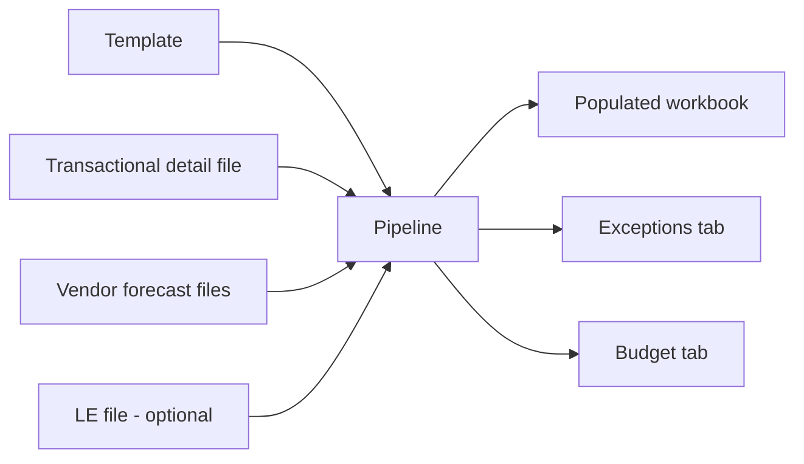

# Financial Automation Project

Fills a Pfizer financial spreadsheet template from vendor forecasts, transactional detail (actuals) files and, optionally, an LE budget file. It writes the populated workbook plus exception reports that show what could not be placed.

[](https://www.python.org/downloads/)
[](https://streamlit.io)
[](#license)

---

## Contents

- [What it does](#what-it-does)
- [Quick start](#quick-start)
- [The two pipelines](#the-two-pipelines)
- [How transactions are placed](#how-transactions-are-placed)
- [Input files and flexible columns](#input-files-and-flexible-columns)
- [Outputs](#outputs)
- [Configuration](#configuration)
- [Streamlit app](#streamlit-app)
- [Project structure](#project-structure)
- [Deployment notes](#deployment-notes)
- [Troubleshooting](#troubleshooting)

---

## What it does



- **Reads** a template, the transactional detail (actuals) file, vendor forecast files and, optionally, the LE file's ERP tab.
- **Builds** a Cost Center (or P3 ID) → WBS → PO hierarchy and places Forecast, Actual, Accrual and Accrual Reversal values by month.
- **Reports** every transaction it could not place cleanly on an Exceptions tab.
- **Finds columns by header text**, not by position, so moved or reordered columns still work.

---

## Quick start

**Requirements:** Python 3.10 or newer (tested on 3.11) and `pip`.

```bash
git clone https://github.com/pfizer-maryoelkers/financial-automation-project
cd financial-automation-project
pip install -r requirements.txt
```

Run everything from the project root.

### Streamlit app (recommended)

```bash
streamlit run app.py
```

1. Upload the template, the transactional detail file and any vendor forecast files. Add the LE file for OpEx if you want the Budget tab and UIDs.
2. The app detects whether the template is **OpEx** or **Project** and shows it in a banner.
3. Click **Generate Report**, then download the workbook.

### Command line

```bash
python -m cli.run                              # auto-detects OpEx vs project from the template
python -m cli.main                             # OpEx only        (configs/config_base.yaml)
python -m cli.project                          # project only     (configs/config_project.yaml)
python -m cli.run configs/config_project.yaml  # explicit config
```

Set the file paths in the matching file under `configs/` first.

### API

```bash
uvicorn api.main:app --reload --port 8000
```

See [docs/README_API.md](docs/README_API.md).

---

## The two pipelines

| | **OpEx** | **Project (CapEx)** |
|---|---|---|
| Grouped by | Cost center → WBS → PO | P3 ID → WBS → PO |
| Template | One main sheet with a cost-center list | A config sheet where you list P3 IDs (`Insert P3 ID HERE`, `Insert P3 HERE` or `Enter All Your P3 IDs` - any "Insert/Enter ... P3" name works) plus a blank `Project Template` sheet |
| Output | The template, populated | One tab per P3 ID, cloned from the blank template |
| Config | `configs/config_base.yaml` | `configs/config_project.yaml` |
| LE file | Optional: fills UIDs and adds a Budget tab | Not used |

`detect_template_type` chooses the pipeline from the template, so `python -m cli.run` and the Streamlit app need no extra setting.

---

## How transactions are placed

Transactions are classified by the document-number prefix (2 = accrual or reversal, 5 = vendor invoice, 9 = reclass), confirmed against the line description.

**Which month a row lands in (OpEx; the project config uses the same rule)**

| Row | Rule |
|---|---|
| Actual, Reversal, Reclass, ER | Period N goes in month N−1. AP01 goes in the prior-year December column, for example `Dec (25)`. |
| Accrual | Direct. AP02 goes in Feb. |
| **Weekly vendors** (Actual with a GL Posting Date) | If the GL Posting Date month equals the Accounting Period month, post in that month with no shift. Otherwise use the Actual rule above. |
| **International POs** (Country India / IN) | Actual, Reversal, Reclass and ER go back **two** months instead of one. Their **forecast** also moves back one month. Accruals are unchanged. |

**Expense reports (ER)**
- A line whose description holds an ER number (for example `ER91389 - SECURITY - SECURITY`) becomes its own PO-style row, with the ER number in the PO column and its transactions beside it. This works on blank and filled templates.
- If the ER line already carries a real `95…` PO, it stays on that PO's row. The Actual cell is filled light green and carries a note saying the transaction was an ER.

**Reclass without a `95…` PO** is treated as a PO row with ` RC` appended.

---

## Input files and flexible columns

| File | Used for |
|---|---|
| Template (`.xlsx`) | The structure that gets filled. |
| Transactional detail (`.xlsx`) | Actuals, accruals, reversals, reclass and ER lines. |
| Vendor forecast (`.xlsx`, optional) | Monthly forecast by PO (`... - FTotal` columns). |
| LE file (`.xlsx`, optional, OpEx) | **ERP tab only**: UID by cost center and the Budget tab (LE0, LE2, LE3, LE4 ...). |

Columns are matched by **header text**. Matching ignores capitalisation, extra spaces, line breaks and a trailing `*`, and the header row can sit anywhere near the top of the sheet. A column can move or be reordered and the tool still finds it. The shared helper is `src/common/col_utils.py`.

Limits:
- A header that is **renamed** (for example "Cost Center*" to "CC") will not match. Add the new name to the reader's alias list.
- Some anchors must stay as they are: the "Previous Period Invoices" marker in column A, the "Contact for PO/ER" label, and the sheet name `ERP`, a P3 config sheet whose name starts with "Insert" or "Enter" and contains "P3", and the sheet `Project Template`.

---

## Outputs

The workbook contains:

1. **The populated template** (or one tab per P3 ID), including ER rows and light-green ER notes.
2. **Budget** (OpEx with an LE file): UID, cost center, description, project code, LE0 and every LE column found, with totals.
3. **Exception_Data** (hidden): raw exception rows for formulas.
4. **Exceptions**: the exception report.

**Exception types:** `Reclass`, `Unmatched Transaction`, `Not Worked on Template`, `Unmatched P3 ID`, `Double Check`, `MISSING_PO`, `DUPLICATE_PO`, `DUPLICATE_WBS`.

**On Template column (project Exceptions tab)**
- **Yes**: the line's amount appears as its own figure on its PO's row on its P3 ID's tab.
- **No**: it does not. That includes lines with no PO and lines whose amount was added into a total with other lines for the same PO, month and type.

---

## Configuration

Settings live in `configs/`:

| File | Purpose |
|---|---|
| `config_base.yaml` | OpEx pipeline: file paths, column map, valid types, writer settings |
| `config_project.yaml` | Project pipeline: P3 template, `shift_months`, column map |
| `config_streamlit.yaml` | Created by the app when you save settings |

Key sections: `template` (header row, PO column, stop marker), `forecast_reader`, `transactional_detail_reader` (`colmap`, `valid_types`, `required_cols`), `le_file`, `template_writer`.

---

## Streamlit app

- **Look:** follows the Pfizer brand: Blue 70 and Blue 90, Pfizer Tomorrow and Diatype fonts, pill buttons, with the spiral after the title and the white logo in the footer. Styling is in `webapp/pfizer_theme.py`. Logos and fonts are embedded in the page, so they show however the app is launched.
- **Month-end banner:** from the 25th through the end of each month (February ends on the 28th), a warning reads "The most up to date actuals file might be AP10 - please double check your team's activity." The AP number follows the calendar month. To preview it early, set `ACTUALS_NOTICE_TEST_DATE=2026-10-26` before starting the app.
- **Theme config:** `.streamlit/config.toml` sets the light theme.

---

## Project structure

```
app.py                        Streamlit entry point
requirements.txt
.streamlit/config.toml        Streamlit theme
static/                       Pfizer logos and fonts
configs/                      YAML configuration
data/                         Sample inputs, templates and LE files
docs/                         API notes and the architecture diagram

webapp/                       Streamlit support code
  streamlit_backend.py        Pipeline orchestration for the UI
  streamlit_config.py         Settings management for the UI
  pfizer_theme.py             Pfizer styling, header, footer, template banner

api/                          FastAPI service
  main.py  backend.py  config.py

cli/                          Command-line entry points
  run.py                      Auto-detects OpEx vs project
  main.py                     OpEx
  project.py                  Project (P3 ID)

src/
  models.py                   Data models and exception types
  readers/                    transactional_detail_reader, forecast_reader,
                              template_reader, project_template_reader
  writers/                    template_writer (workbook, Exceptions, Budget tab)
  pipeline/                   utils (OpEx hierarchy), project_utils (project hierarchy)
  common/                     col_utils (find columns by header), notices (banner)

tools/                        One-off maintenance scripts
```

---

## Deployment notes

- **Entry point:** `app.py` at the repository root. Keep `static/` and `.streamlit/` with the code.
- **Slimmer install:** `requirements.txt` pins many packages the app does not need (Jupyter and others). A hosted build only needs `streamlit`, `pandas`, `openpyxl`, `PyYAML`, `numpy` and `python-dateutil`. Add `fastapi`, `uvicorn` and `python-multipart` only for the API.
- **Data sensitivity:** uploads contain financial transaction data. Do not host the app on a public service without IT security approval. The repo also holds Pfizer brand fonts and logos.
- **No persistence:** uploads and outputs live in a temporary folder, so download the workbook right after each run.
- **Speed:** large transactional files use a faster Excel reader (`src/common/fast_excel.py`), and the parsed file is cached in the system temp folder (`financial_automation_cache`, cleared after 7 days). The first run of a file takes longest; running the same file again is much faster. The cache is keyed on the file's contents, so an edited file is always re-read.
- **Large uploads:** the default limit is 200 MB per file. Raise `server.maxUploadSize` in `.streamlit/config.toml` if needed.

---

## Troubleshooting

| Issue | What to check |
|---|---|
| "No valid sheets found" | The file needs a period column (`Accounting Period`, `Fiscal Year/Period`, `Period` or `Month`), a PO column and an amount column. |
| A column is not found | Check the header text. Spacing, case and `*` don't matter, but a renamed header does. |
| LE file not read | Needs an `ERP` tab with a `Cost Center` header in the top 60 rows. |
| Logo or fonts missing | Restart the app and press Ctrl+F5. Make sure `static/` was deployed. |
| Generate Report is greyed out | Upload a template first. |
| "No cost centers were found" | OpEx template: list your cost centers in column A under the "Cost Center" header, above the "EXPENSE" row. |
| "No P3 IDs were found" | Project template: on the P3 config sheet list each P3 ID in column A with a tab name in column B. |
| Wrong month for a transaction | See [How transactions are placed](#how-transactions-are-placed). Check the GL Posting Date, the Country (international POs) and the period. |

---

## License

Internal Pfizer project. All rights reserved.

**Last updated:** October 2026 · **Maintained by:** Mary Oelkers
